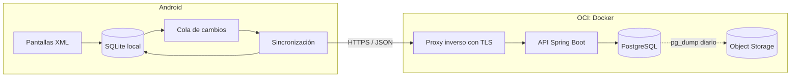

# ADR-001: Backend propio para el servicio multi-club

- **Estado:** aceptado
- **Fecha:** 2026-11-08 (diseño de la identidad agregado el 2026-11-10, con la entrega 3)
- **Alcance:** Fase 2 de la hoja de ruta (seguridad y servicio)

## Contexto

La app es un cliente Android en Kotlin con Views XML que guarda todo en SQLite local (`SQLiteOpenHelper`, esquema v4). Funciona sin red y administra un solo club por instalación. Hoy:

- **El login no es seguro.** `LoginCredentials` compara contra una lista de usuarios incluida en el APK, y la contraseña es igual al usuario.
- **No hay usuarios, roles ni sesiones.** El nombre de usuario viaja entre pantallas como un extra del `Intent`.
- **Un club por dispositivo.** `club_configuration` tiene una sola fila (`id = 1`) y ninguna tabla tiene `club_id`.
- **Ids locales.** Casi todas las tablas usan enteros autoincrementales, que chocarían si dos dispositivos crean registros sin conexión. `profesores` usa el DNI como clave primaria.
- **Borrados mixtos.** Clientes y horarios se dan de baja con un borrado lógico. Las actividades del catálogo y los descuentos sin uso, los beneficios y la relación entre actividad y profesor se borran físicamente.
- **Lógica de negocio pura en Kotlin.** `ChargeCalculator`, `VencimientoCalculator` y los validadores no dependen de Android y tienen tests JVM.

El objetivo de la Fase 2 es tener autenticación real, usuarios con roles, un backend HTTPS para varios clubes con sus datos aislados, funcionamiento offline con sincronización, y backup con restauración probada.

El proyecto es, ante todo, una pieza de portfolio que se presenta como SaaS. No hay apuro comercial, así que se prioriza demostrar diseño y operación de backend por sobre salir rápido al mercado.

### Restricciones que se mantienen

- No se integran pagos reales. Las cuotas y los pagos de actividades siguen siendo registros manuales que carga el personal del club.
- La app sigue en Kotlin, Views XML, AppCompat, Material y `SQLiteOpenHelper`. No se suman Compose, Room, Hilt ni Navigation.
- No se registran datos personales en logs, capturas ni reportes de errores.

## Decisión

Construir una **API propia en Spring Boot con Kotlin y PostgreSQL**, desplegada con Docker en la plataforma existente de OCI detrás de HTTPS.

La app pasa a ser **offline-first**: SQLite sigue siendo la base con la que trabaja la interfaz, y una capa de sincronización envía los cambios pendientes y trae los del servidor. El club deja de estar implícito: cada dato pertenece a un club y el servidor lo hace cumplir en cada operación.

## Opciones consideradas

| Criterio | Supabase | Firebase | API propia (Ktor) | **API propia (Spring Boot)** |
|---|---|---|---|---|
| Valor para el CV | Medio: integración de un servicio | Bajo-medio | Alto | **Alto, y es lo más pedido en ofertas de backend** |
| Aislamiento entre clubes | Bueno, con reglas por fila de Postgres | Reglas de seguridad por documento | Lo diseñamos nosotros | **Lo diseñamos nosotros, con reglas por fila como respaldo** |
| Offline y sincronización | Hay que construirla en la app | Viene resuelta | Hay que construirla | **Hay que construirla** |
| Encaje con el modelo actual | Relacional, muy parecido | Documental, hay que rehacerlo | Relacional | **Relacional** |
| Dependencia del proveedor | Media: es Postgres y se puede autoalojar | Alta | Ninguna | **Ninguna** |
| Costo de infraestructura | Plan gratuito con límites; después, pago por proyecto | Pago por lecturas y escrituras | Casi nulo en OCI | **Casi nulo en OCI** |
| Esfuerzo | Bajo | Bajo-medio | Alto | **Alto** |
| Operación | La resuelve el proveedor | La resuelve el proveedor | A cargo nuestro | **A cargo nuestro** |

**Supabase** es la alternativa más rápida y la que menos ata a un proveedor, pero deja la parte más valiosa para el portfolio (autenticación, autorización y aislamiento) en manos del servicio. **Firebase** resuelve el offline, pero obliga a pasar de un modelo relacional a uno documental y es el que más ata. **Ktor** encaja muy bien con Kotlin, pero aparece mucho menos en búsquedas laborales que Spring Boot, que con Kotlin tiene soporte de primera.

## Arquitectura

### Varios clubes en una misma base

- **Modelo:** una sola base y un solo esquema, con una columna `club_id` en cada tabla de datos del club. Se descarta un esquema por club: multiplica las migraciones y complica la operación sin aportar a esta escala.
- **Dónde se aplica:** el `club_id` sale del token del usuario, nunca de un parámetro que mande la app. La capa de servicios lo exige y todas las consultas filtran por él.
- **Respaldo en la base:** reglas por fila de PostgreSQL (row-level security), con el club activo fijado en cada transacción. Si una consulta se olvida del filtro, la base igual no devuelve datos de otro club.
- **Pruebas:** cada endpoint tiene un test que intenta leer y escribir datos de otro club y debe fallar.

### Identidad, roles y sesiones

- **Usuarios:** email y contraseña con hash Argon2id. Un usuario puede pertenecer a más de un club con un rol distinto en cada uno.
- **Roles:** administrador, recepción, caja y solo lectura. Los permisos se validan en el servidor en cada operación. La app oculta lo que el rol no permite, pero no es la que decide.
- **Tokens:** un token de acceso de vida corta (15 minutos) y un token de renovación opaco que rota en cada uso. El servidor guarda el hash del token de renovación, así que cerrar sesión o dar de baja a un usuario lo invalida de inmediato. El token de acceso ya emitido sigue valiendo hasta que vence, como máximo 15 minutos.
- **En el dispositivo:** el token de renovación se guarda cifrado con una clave del Android Keystore. Nada de credenciales en el APK.
- **Alta de un club:** un endpoint crea el club y su administrador. El administrador da de alta a su personal con una contraseña temporal que hay que cambiar en el primer ingreso. Las invitaciones por email quedan para más adelante porque requieren un proveedor de correo.
- **Fuerza bruta:** límite de intentos de login por cuenta y por IP.

### Diseño de la identidad (entrega 3)

**Elegir el club al ingresar.** `POST /auth/login` recibe un `clubId` opcional. Sin él, la sesión se abre en el club del último ingreso o, si nunca ingresó, en el de la membresía más antigua. La respuesta siempre trae el club activo y la lista de todos los clubes de la cuenta con su rol. Para pasar a otro club, `POST /auth/refresh` con `clubId` rota el token y cambia el club de la misma sesión, sin volver a pedir la contraseña. Se eligió así porque:

- quien tiene un solo club, que es lo más común, ingresa en un paso;
- el login tiene una sola forma de respuesta, siempre con tokens;
- cambiar de club no obliga a guardar ni a reenviar la contraseña.

Un `clubId` de un club sin membresía activa responde 403 y no consume el token de renovación.

**Tokens y sesiones.**

- El token de acceso es un JWT firmado con HS256. La clave sale de la variable de entorno `CLUB_AUTH_JWT_SECRET` (Base64, 32 bytes o más). Sin ella, o si es corta, la API no arranca.
- Los claims son la cuenta (`sub`), el club activo (`club`), el rol en ese club (`role`), la sesión (`sid`) y si falta cambiar la contraseña temporal (`pwd_change`). El token no lleva email ni nombre.
- Una sesión es un ingreso de una cuenta a un club. El token de renovación tiene 256 bits al azar, se guarda solo su SHA-256 y vence a los 30 días. Cada renovación lo marca como usado y emite uno nuevo en la misma sesión.
- Si llega un token ya usado, alguien lo copió: se revoca la sesión entera, así tampoco sirve el token nuevo que se emitió con él. La renovación bloquea la fila del token, así que dos pedidos simultáneos con el mismo token no pasan los dos.
- Cerrar sesión revoca la sesión. Dar de baja a alguien de un club revoca sus sesiones en ese club. Cambiar la contraseña revoca todas las sesiones de la cuenta, en todos sus clubes.

**Alta de club y de personal.**

- `POST /clubs` es público y crea el club con su administrador. Si el email ya tiene cuenta, responde 409.
- El administrador suma personal con `POST /members`. Si el email no tiene cuenta, el servidor genera una contraseña temporal de 12 caracteres, sin los que se confunden al dictarla, y la devuelve una sola vez.
- Mientras la contraseña temporal no se cambie, el token no tiene ningún rol y solo sirve para `POST /auth/password`.
- Si el email ya tiene cuenta en otro club, se le suma este club con el rol pedido y conserva su contraseña. Así es como una persona llega a tener varios clubes. El administrador se entera de que esa cuenta existe, algo aceptable mientras no haya invitaciones por email.
- La baja marca la membresía como inactiva. Volver a sumar a la persona la reactiva. Nadie puede darse de baja a sí mismo, así el club nunca queda sin un administrador.
- En esta entrega, el personal solo lo administra el rol administrador. Los permisos de cada operación de negocio llegan con la entrega 8.

**Aislamiento en la base.** Las operaciones abren su transacción con `DatabaseContext`, en uno de dos contextos:

- **De club:** la transacción pasa al rol `club_app`, que no es dueño de las tablas y por eso cumple las reglas por fila. También fija el club activo con `set_config('app.club_id', ..., true)`. Las dos cosas duran solo hasta el final de la transacción, así la conexión vuelve al pool limpia.
- **De identidad:** alta de club, login, renovación y cambio de contraseña no pertenecen a un solo club. Corren con el usuario dueño de las tablas, al que las reglas no se aplican.

Las capas de protección son estas:

- Los repositorios de datos de club toman el club del contexto y fallan si se los usa fuera de él.
- Las reglas de `clubs`, `club_memberships` y `sessions` filtran por el club activo. Sin club activo, no dejan ver ni escribir nada.
- Una cuenta solo es visible desde los clubes donde tiene membresía.
- `club_app` no puede leer el hash de las contraseñas ni los tokens de renovación.
- Para encontrar por email a una cuenta de otro club hay una función `SECURITY DEFINER` que solo devuelve el id.
- Ninguna ruta recibe el club como parámetro, y el cuerpo de los pedidos rechaza los campos desconocidos: un `clubId` de más responde 400.

**Fuerza bruta y privacidad.**

- Se permiten 5 intentos fallidos por cuenta y 20 por IP en ventanas de 15 minutos. Pasado el límite, la respuesta es 429 con `Retry-After`.
- La cuenta se cuenta por el email normalizado, exista o no.
- Un email inexistente y una contraseña incorrecta responden igual. En los dos casos se verifica un hash Argon2id, así el tiempo de respuesta tampoco delata qué cuentas existen.
- Argon2id usa 19 MiB, 2 pasadas y 1 hilo, el mínimo que recomienda OWASP.
- Los logs registran ids de cuenta, sesión y club. Nunca emails, contraseñas, tokens ni IPs.
- Los errores no controlados registran solo el tipo de excepción y dónde ocurrió, porque el mensaje puede traer datos de la consulta.

**Límites conocidos.**

- Los contadores de intentos viven en memoria: valen para una sola instancia y se reinician con ella.
- La IP es la del pedido. Detrás del proxy de la entrega 4 hay que tomarla de los encabezados reenviados.
- El token de acceso sigue valiendo hasta 15 minutos después de cerrar la sesión o de una baja.
- La contraseña temporal no vence.

### Datos en el servidor

- Cada tabla de datos del club replica la local y suma `club_id`, un `id` UUID, `version`, `updated_at`, `updated_by` y `deleted_at`. Los borrados pasan a ser lógicos para que se puedan sincronizar.
- **Importes en `NUMERIC(12,2)`**, no en coma flotante.
- **El DNI es único dentro de cada club**, no en toda la base: una misma persona puede ser socia de dos clubes. `profesores` deja de usar el DNI como clave primaria.
- Migraciones versionadas con Flyway.

### Ids que no chocan sin conexión

Los registros nuevos reciben un UUID generado en el dispositivo, así dos equipos pueden crear datos sin conexión sin pisarse. En SQLite, la migración a la v5 suma una columna `uuid` a cada tabla y mantiene los ids enteros actuales, así el código existente sigue funcionando.

### Sincronización

La app trabaja siempre contra SQLite. La sincronización corre al abrir la app, después de cada cambio si hay conexión y periódicamente en segundo plano.

- **Envío:** cada cambio local se guarda en una cola junto con la versión del registro que se editó. La app manda la cola en lotes. El servidor aplica cada cambio en una transacción y lo identifica con un id propio, así reenviarlo no lo duplica.
- **Recepción:** el servidor numera los cambios de cada club en una secuencia creciente. La app pide "todo lo posterior al último número que recibí" y lo aplica en SQLite.
- **Conflictos:** según el tipo de dato.
  - **Pagos y cuotas:** solo se agregan, nunca se editan. Una corrección es una anulación con contramovimiento, que es justamente lo que pide la Fase 3. Así no hay conflictos de edición sobre la plata.
  - **Clientes, catálogo, horarios y configuración:** control de versión optimista. Si el registro cambió en el servidor desde que se editó en el dispositivo, el servidor rechaza ese cambio y devuelve la versión actual. La app lo muestra en una lista de conflictos para que el personal elija qué versión conservar. No hay "gana el último" silencioso.
  - **Reglas de negocio:** el servidor las vuelve a validar. Si dos equipos registran sin conexión la cuota del mismo socio para el mismo mes, el segundo se rechaza y aparece como conflicto.

### Lógica compartida

`ChargeCalculator`, `VencimientoCalculator` y los validadores pasan a un módulo Kotlin puro (`shared`) que usan la app y el backend. El servidor recalcula cada cobro con exactamente las mismas reglas que la app, en lugar de confiar en el importe que llega.

### API

- REST con JSON, versionada en `/api/v1` y documentada con OpenAPI.
- Errores con el formato estándar de detalles de problema (RFC 9457).
- Endpoints principales: autenticación (`/auth/login`, `/auth/refresh`, `/auth/logout`, `/auth/password`), alta de clubes (`POST /clubs`), club activo (`GET /club`), administración de miembros (`/members`), `/sync/push` y `/sync/pull`.

### Cliente Android

- **HTTP:** OkHttp con kotlinx.serialization, que son livianos. No se suma Retrofit.
- **Asincronía:** corrutinas de Kotlin.
- **Sincronización en segundo plano:** WorkManager, que reintenta y respeta la batería y la conectividad.
- **Variante demo:** sigue funcionando sin backend, con los datos de ejemplo y un ingreso local de demostración, para que se pueda probar sin servidor. La variante production exige el backend.

### Despliegue y operación

- **Contenedores:** API, PostgreSQL y un proxy inverso que obtiene y renueva el certificado TLS solo, en la plataforma Docker de OCI.
- **Secretos:** fuera del repositorio, en archivos de entorno del servidor.
- **Backups:** `pg_dump` diario a OCI Object Storage con retención. Hay un procedimiento escrito de restauración y se prueba restaurando de verdad en una base aparte.
- **Monitoreo:** logs estructurados sin datos personales, un endpoint de salud y un chequeo externo de disponibilidad.
- **Límite conocido:** una sola VM es un punto único de falla. Alcanza para portfolio y piloto. Si hubiera clientes pagos, el paso siguiente es una base PostgreSQL administrada.

### CI/CD

GitHub Actions en cada PR:

- **Backend:** compilación y tests, incluidos los de integración con Testcontainers contra un PostgreSQL real.
- **Android:** compilación, tests JVM y Lint.
- **Despliegue:** se dispara al crear una etiqueta de versión, publicando la imagen y actualizando el servidor.

## Consecuencias

**A favor**

- Muestra el ciclo completo de un SaaS: autenticación, autorización, datos de varios clubes aislados, sincronización offline, despliegue, backups y CI/CD.
- No depende de ningún proveedor y el costo de infraestructura es casi nulo.
- Las reglas de cobro viven en un solo lugar y valen igual en la app y en el servidor.

**En contra**

- Es la opción que más trabajo lleva. La sincronización con conflictos es la parte más compleja.
- La operación, la seguridad y las actualizaciones quedan a nuestro cargo.
- La app suma dependencias nuevas (OkHttp, kotlinx.serialization, corrutinas, WorkManager) y una migración de SQLite a la v5.

## Plan de entregas

Cada entrega es un PR con sus tests y, cuando cambia la interfaz, evidencia visual.

1. **Base del repo:** estructura de módulos, módulo `shared` con la lógica de cobro (sin cambiar comportamiento) y CI para Android.
2. **Esqueleto del backend:** Spring Boot, endpoint de salud, Flyway, PostgreSQL local con Docker Compose, Testcontainers, OpenAPI y CI.
3. **Identidad:** usuarios, clubes, membresías y roles; login, renovación y cierre de sesión; alta de club; tests de aislamiento entre clubes.
4. **Despliegue:** HTTPS en OCI, backups automáticos y una restauración probada.
5. **Login real en la app:** la variante production usa el backend, guarda el token cifrado, maneja expiración y cierre de sesión, y muestra lo que permite cada rol.
6. **Datos del club en el servidor:** esquema de negocio en PostgreSQL y SQLite v5 (UUID, versión, borrados lógicos y cola de cambios) con migración.
7. **Sincronización:** envío, recepción, conflictos y una pantalla con el estado de la sincronización y los conflictos pendientes.
8. **Permisos por rol** en cada operación, en el servidor y en la app.
9. **Carga inicial:** subir los datos de una instalación existente al dar de alta su club.

## Decisiones tomadas

1. **El backend vive en este mismo repo**, con los módulos `app/`, `backend/` y `shared/`. El módulo compartido se usa directo, sin publicar artefactos, y el portfolio muestra todo junto.
2. **La app suma OkHttp, kotlinx.serialization, corrutinas y WorkManager.** Retrofit, Room y Hilt siguen fuera.
3. **La variante demo sigue funcionando sin backend.**
4. **El personal se da de alta con una contraseña temporal.** Las invitaciones por email quedan para más adelante.
5. **El club se elige al ingresar y se cambia con la renovación**, sin volver a pedir la contraseña. Ver "Diseño de la identidad".
6. **Tokens de acceso JWT con HS256** y clave tomada del entorno. Una sola API firma y verifica, así que no hace falta un par de claves.
7. **Reglas por fila con un rol propio (`club_app`)** para las operaciones de club. Las de identidad corren con el usuario dueño de las tablas.
8. **El límite de intentos vive en memoria.** Alcanza con una sola instancia. Si hubiera varias, pasaría a la base o a un almacén compartido.

## Decisiones abiertas

Se resuelven antes de la entrega 4 (despliegue):

1. **Dónde vive la infraestructura (Terraform):** en este repo o en el repo de infraestructura existente.
2. **Qué dominio usa la API:** hace falta uno para el certificado HTTPS.

## Fuera de alcance

- Panel web.
- Cobro real de suscripciones a los clubes.
- Envío de emails y notificaciones push.
- Recibos, anulaciones y cierre de caja, que son de la Fase 3, aunque el modelo de pagos ya queda preparado para eso.
